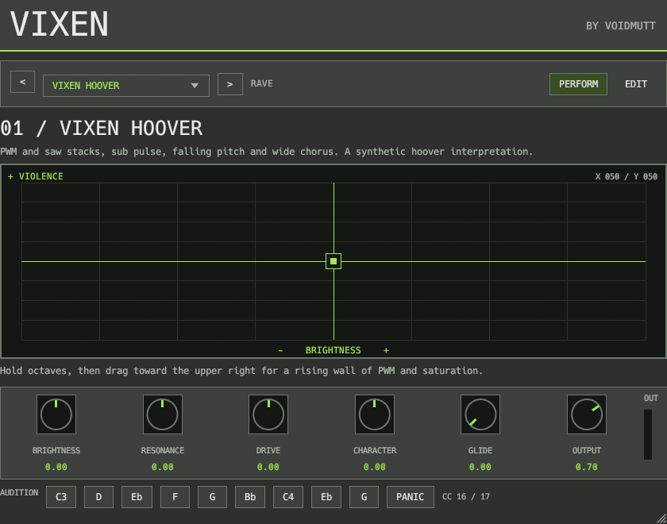
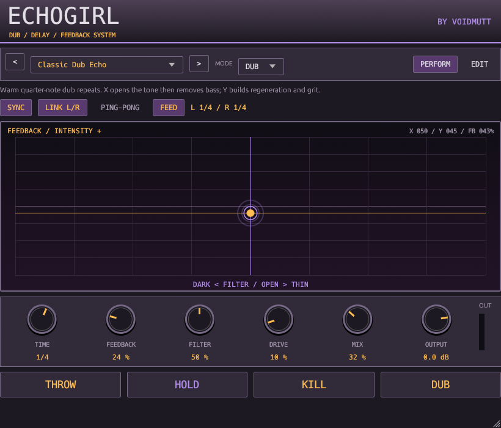
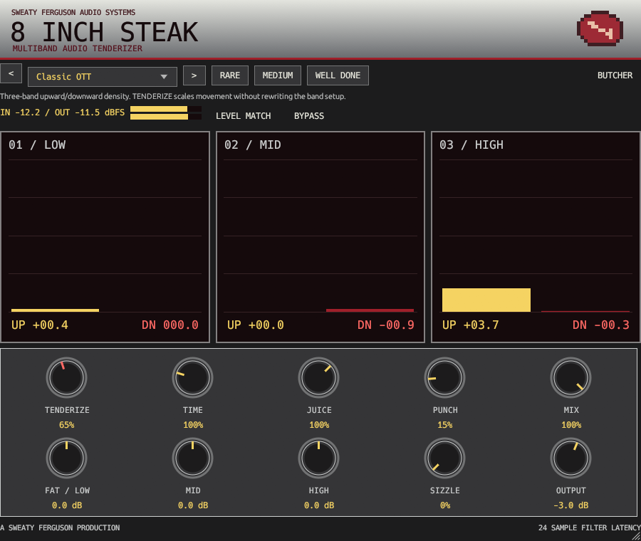
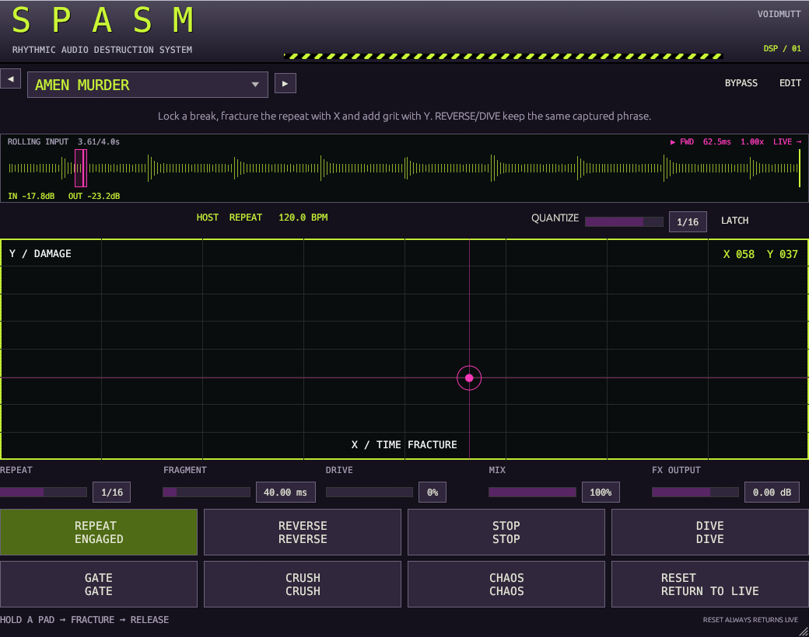

<div align="center">

# VOIDMUTT VSTs

**Instruments and effects for rave music, feedback, and rhythmic destruction.**

Windows x64 &nbsp; | &nbsp; VST3 &nbsp; | &nbsp; GPL-3.0-or-later

[Plugins](#the-collection) &middot; [Releases](#releases) &middot; [FL Studio setup](#use-in-fl-studio) &middot; [Build](#build-from-source) &middot; [Documentation](#engineering--documentation)

**BY VOIDMUTT**

</div>

Four independent plugins built for hands-on electronic music production. Start
with a useful sound or effect, grab the performance controls, and record the
result. Open the editor when you want to change the underlying patch.

Original synthesis and DSP, editable factory recipes, portable user patches and
host automation. No proprietary factory recordings or sampled commercial presets.
Each plugin works in a compatible VST3 host without DAWJ.

## The collection

| Plugin | Type | Made for | Start here |
|---|---|---|---|
| **VIXEN** | Synth instrument | Hoovers, supersaws, Reese bass, acid, trance plucks and hardcore leads | Load a patch, play MIDI, move the X/Y pad |
| **ECHOGIRL** | Stereo delay effect | Dub throws, tape drift, filtered feedback and sustained regeneration | Insert on audio, choose a preset, try THROW and HOLD |
| **8 INCH STEAK / EIS** | Multiband dynamics effect | Upward/downward compression, density, tonal shaping and saturation | Turn TENDERIZE; open BUTCHER for per-band control |
| **SPASM** | Stereo glitch effect | Beat repeats, reverse cuts, tape stops, pitch dives and rhythmic damage | Play audio through it, hold a pad, release to return live |

### VIXEN

A fully programmable rave synthesizer with a performance-first interface. Ten
factory patches cover distinct hard-dance and rave archetypes. Each patch has
its own expressive X/Y mappings; EDIT exposes oscillators, envelopes, filters,
modulation, effects and the mapping system itself.



Play with velocity, pitch bend, modulation wheel and sustain. Automate X/Y and
the prominent performance controls. Save original patches or derive new versions
of factory sounds. The grey-and-green interface keeps the controls prominent.

[Patch format and authoring](docs/patch-format.md) &middot;
[Sound design](docs/sound-design.md) &middot; [Editor screenshot](docs/images/vixen-edit.png)

### ECHOGIRL

A stereo dub delay intended for live manipulation. CLEAN, TAPE, DIRTY and DUB
characters share a controllable feedback path, with filtering, saturation,
independent delay times, tempo synchronization and ping-pong routing.



Use **THROW** to inject a phrase, **HOLD** to sustain its echo, **DUB** to change
its performance character, and **KILL** to release the buildup. The large X/Y pad
couples filter movement with feedback intensity. Ten presets and editable
performance mappings provide useful starting points.

[Operator guide](docs/echogirl.md) &middot; [Editor screenshot](docs/images/echogirl-edit.png)

### 8 INCH STEAK

**MULTIBAND AUDIO TENDERIZER**  
*A Sweaty Ferguson Production*

Three-band dynamics with simultaneous upward and downward compression,
adjustable crossovers, stereo-linked detection and optional saturation.
**TENDERIZE** sets the immediate intensity; **JUICE**, **FAT** and **SIZZLE** keep
the main view approachable while tooltips retain the actual DSP terminology.



Open **BUTCHER** for detailed band controls, spectrum and dynamics displays.
Easy and advanced views operate on the same state. Factory presets range from
restrained glue to deliberately excessive compression; they are starting points,
not universal mastering settings.

[Operator guide](docs/eis.md) &middot; [BUTCHER screenshot](docs/images/eis-butcher.png)

### SPASM

**RHYTHMIC AUDIO DESTRUCTION SYSTEM**

A bounded rolling audio buffer turns incoming material into repeats, stutters,
reverse phrases, tape stops and pitch dives. Gate, crush, filter and drive add
performance coloration. Quantization and a deterministic effect-priority system
keep overlapping actions predictable.



Hold a pad, move **TIME FRACTURE / DAMAGE**, then release. **RESET** cancels the
performance and returns clean according to the release policy. Ten factory
performances, editable mappings and an advanced editor support original setups.

[Operator guide](docs/spasm.md) &middot; [Editor screenshot](docs/images/spasm-edit.png)

## Releases

**[GitHub Releases](https://github.com/khodges42/VSTs/releases)** is the download
location for published packages. **No GitHub releases are published yet**; build
from source using the instructions below. A GitHub source ZIP is source code,
not an installable plugin package. No binary release is created by this README.

Current source versions:

| Plugin | Version | Notes |
|---|---|---|
| VIXEN | **0.1.1** | Fixes the reproduced chorus-buffer wrap crash during long idle operation |
| SPASM | **0.1.1** | Removes the character icon from its interface |
| ECHOGIRL | **0.1.0** | Initial stereo dub-delay implementation |
| 8 INCH STEAK / EIS | **0.1.0** | Initial multiband dynamics implementation |

See the [idle-crash investigation and replacement guide](docs/idle-crash-fix.md)
for the VIXEN fix. These are unsigned development builds with documented tests
and limitations, not a claim of qualification in every DAW or live setting.
Windows x64 is the current build target; macOS/Linux binaries are not supplied.

## Use in FL Studio

### Add the plugins

1. Obtain or build the Windows x64 bundles. Keep each **complete `.vst3` folder**;
   do not extract only the file inside `Contents/x86_64-win`.
2. Copy the bundles to a VST3 installation directory, for example
   `C:\Program Files\Common Files\VST3` (Windows may request administrator access).
3. In FL Studio, open **Options > File settings > Manage plugins**. Enable
   **Verify plugins**, then select **Find installed plugins**. For an update,
   enable rescanning previously verified plugins as needed.
4. Load **VIXEN** from the Channel Rack's **+ / More plugins** as an instrument.
   Load **ECHOGIRL**, **8 INCH STEAK** or **SPASM** in a **Mixer effect slot**.
   EIS appears under its full host name, **8 INCH STEAK**.

No build script installs into system folders. Image-Line's
[installation guide](https://www.image-line.com/fl-studio-learning/fl-studio-online-manual/html/basics_externalplugins.htm)
explains scanning, classification and favorites. If an update seems unchanged,
check the loaded file path and reopen the instance after replacing the bundle.

### Automate a performance

Move a performance knob, then choose **Tools > Last tweaked > Create automation
clip**. For separate X/Y clips, choose **Browse parameters** from the plugin
wrapper menu and right-click **X** or **Y** in FL's Browser.

The plugins expose automation, but their custom interfaces do not currently open
FL Studio's native right-click parameter menu. Some EDIT controls modify draft
patch data rather than individual host parameters. See the
[FL Studio automation guide](docs/fl-studio-automation.md) for the supported
workflow, limitations and scope of native-menu support.

## Build from source

Requirements: **Windows x64**, Rustup, **Visual Studio Desktop C++ Build Tools**
with Windows SDK, and **Python 3.10+**. The repository pins **Rust 1.93.0**.
The initial dependency fetch requires network access, including GitHub; subsequent
bundle builds use the locked dependency graph offline.

From the repository root:

```powershell
cargo fetch --locked
powershell -NoProfile -ExecutionPolicy Bypass -File scripts/bundle.ps1 -Plugin VIXEN
powershell -NoProfile -ExecutionPolicy Bypass -File scripts/bundle.ps1 -Plugin ECHOGIRL
powershell -NoProfile -ExecutionPolicy Bypass -File scripts/bundle.ps1 -Plugin EIS
powershell -NoProfile -ExecutionPolicy Bypass -File scripts/bundle.ps1 -Plugin SPASM
```

Each command produces its bundle under `target/bundled/`, including factory files
and collected dependency notices. The PowerShell flag applies to that invocation;
it does not change the machine's execution policy. Use `-DebugBuild` for Debug.

```text
target/bundled/
  VIXEN.vst3/
  ECHOGIRL.vst3/
  EIS.vst3/
  SPASM.vst3/
```

Each bundle contains `Contents/x86_64-win/<bundle-name>.vst3` and accompanying
resources. Keep that structure intact when copying or packaging it.
These are host plugins, not standalone live-audio executables.

## Patches, presets and sessions

Factory recipes are starting points you can inspect and modify. Use each
plugin's editor and save/import/export controls to retain original user versions.
Portable JSON formats are versioned and validated; host sessions preserve the
applied state. Apply pending draft edits before expecting them in playback or a
saved session. VIXEN preserves global output while browsing patches.

The operator guides document each product's exact save, switching, latch and
release behavior. Avoid substituting one plugin's preset format for another.
Do not assume that every editor field is independently automatable.

## Engineering & documentation

The plugins use Rust DSP cores with independent VST3 wrappers and native egui
editors. DAWJ is an eventual integration target, not a runtime dependency.
Processing is designed around bounded state and prepared buffers; GUI/filesystem
work stays outside the DSP path. Framework lifecycle limitations, including state
restoration boundaries, are documented rather than treated as production guarantees.

| Product | Architecture | Validation |
|---|---|---|
| VIXEN | [Engine and integration boundary](docs/architecture.md) | [Tests and limitations](docs/validation.md) |
| ECHOGIRL | [Delay architecture](docs/echogirl-architecture.md) | [Validation record](docs/echogirl-validation.md) |
| EIS | [Dynamics architecture](docs/eis-architecture.md) | [Measurements and validation](docs/eis-validation.md) |
| SPASM | [Performance architecture](docs/spasm-architecture.md) | [Validation record](docs/spasm-validation.md) |

Run the workspace checks after fetching dependencies:

```powershell
cargo fmt --all -- --check
cargo check --workspace --locked --offline
cargo clippy --workspace --all-targets --locked --offline -- -D warnings
cargo test --workspace --locked --offline
python scripts/dependencies.py
```

Offline renderers and independent native hosts are included for reproducible
checks. For example, after building VIXEN:

```powershell
cargo run --release -p vixen-render --locked --offline -- --out target/demos --bank factory/vixen
cargo run --release -p vixen-host --locked --offline -- smoke target/bundled/VIXEN.vst3
```

The renderer creates default and moving-X/Y examples for each factory patch. The
host loads the actual VST3 and checks note offsets, state and reference audio.
It does not open an audio device. A development editor inspection window is not
a standalone performance host. Run the external
[pluginval](https://github.com/Tracktion/pluginval) tool separately when validating
host behavior. Automated tests do not establish subjective sound quality or every
FL Studio interaction.

## Contributing

Useful reports include the plugin version, operating system and DAW version,
loaded binary path, preset, repeatable steps and expected behavior. Include a
portable user patch when it reproduces the problem. Keep DSP changes separate
from interface work, preserve stable parameter/state identifiers, and run the
checks appropriate to the change. Retain source and asset licensing notices.

## License & credits

Original code and factory recipes are **GPL-3.0-or-later**. See [LICENSE](LICENSE),
[NOTICE](NOTICE) and the [dependency/license record](docs/licensing.md). NIH-plug,
egui, VST3 bindings and fonts retain their own grants and notices; the combined
VST3 build uses the applicable GPLv3 option. Original product graphics are
code-native; no copied anime characters or proprietary instrument samples are
required. VST is a trademark of Steinberg Media Technologies GmbH.

**VOIDMUTT** is the original project credit. **Sweaty Ferguson Audio Systems** is
the fictional manufacturer identity for 8 INCH STEAK.

### Related project

**[RiffCalc 2000 Pro (Workgroup Edition)](https://github.com/khodges42/RiffCalc)**,
formerly PACKRAT, is now an independent generative MIDI workstation. Its source,
builds and documentation live in its own repository; it is not bundled here.
