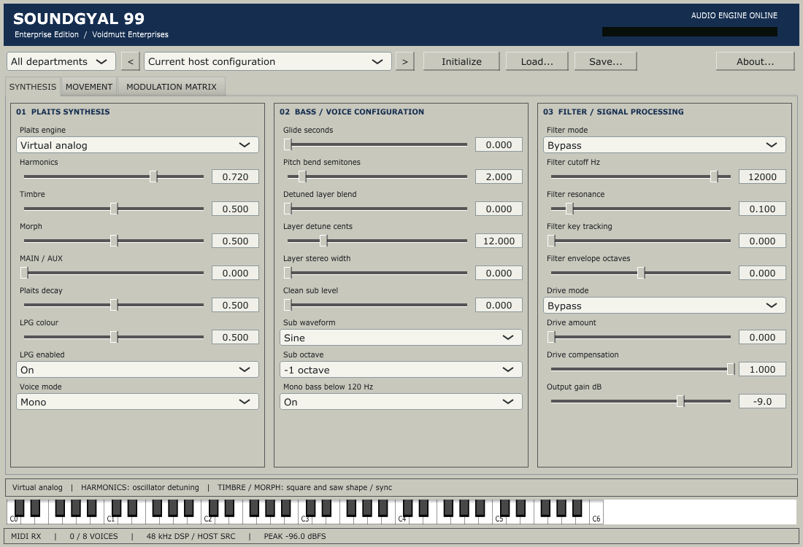
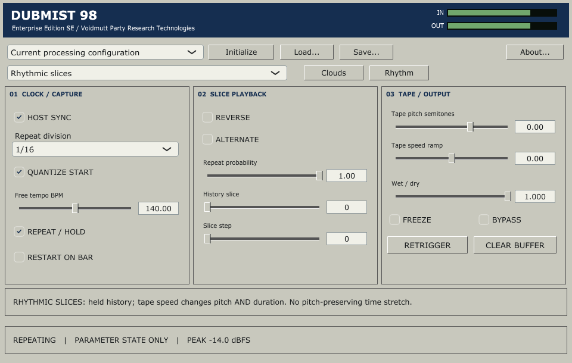

# VOIDMUTT VSTs

**Desktop instruments and effects for rave music, bass, feedback and rhythmic damage.**  
Windows x64 / VST3 / GPLv3

[Install packages](releases/README.md) · [Build and host guide](docs/build-and-host-guide.md)

Six independent plugins. Instruments take MIDI; effects process incoming audio.
Each works through standard VST3 hosting without depending on DAWJ.

## SOUNDGYAL 99 Enterprise Edition

A synthesizer built on **Mutable Instruments Plaits, by Emilie Gillet**: all 24
engine slots, plus sub-bass, detuned layers, filtering, drive, envelopes and a
modulation matrix. Includes 35 editable factory presets.



[Manual, build and validation](plugins/soundgyal99/README.md)

## Dubmist 98 Enterprise Edition SE

An audio effect built on **Mutable Instruments Clouds, by Emilie Gillet**.
Original granular, stretch, looping-delay and spectral modes meet independent
Monsoon-style blend controls and a host-synchronized rhythmic slice mode with
reverse, stepping and tape-speed movement. Twelve factory configurations.



[Manual, build and validation](plugins/dubmist98/README.md) · [Rhythm controls](plugins/dubmist98/docs/rhythm-milestone.md)

SOUNDGYAL and Dubmist are functional previews. Listening review and FL Studio/DAWJ
validation remain outstanding; Dubmist's bass-preservation crossover is not implemented.

## VIXEN

A programmable rave synth for hoovers, Reese bass, supersaws, acid and plucks.
Use the performance pad, then open EDIT for the underlying patch and modulation.


[Sound design](docs/sound-design.md) · [Validation](docs/validation.md)

## ECHOGIRL

Stereo dub delay with clean, tape, dirty and dub characters. THROW, HOLD and KILL
support hands-on feedback performance; EDIT exposes the details.


[Operator guide](docs/echogirl.md) · [Validation](docs/echogirl-validation.md)

## 8 INCH STEAK / EIS

Multiband dynamics with upward/downward compression, crossovers and saturation.
TENDERIZE handles broad changes; BUTCHER opens the band controls and displays.


[Operator guide](docs/eis.md) · [Validation](docs/eis-validation.md)

## SPASM

A rolling-buffer effect for beat repeats, stutters, reverse phrases, tape stops
and pitch dives. Hold a performance pad, adjust TIME FRACTURE / DAMAGE, then release.


[Operator guide](docs/spasm.md) · [Validation](docs/spasm-validation.md)

## Install

1. Open the [release directory](releases/README.md) and choose a Windows x64 package.
2. Close your DAW. Copy the **complete `.vst3` folder**, including `Contents`, to
   a VST3 folder your host scans, commonly `C:\Program Files\Common Files\VST3`.
3. Rescan plugins. Load VIXEN or SOUNDGYAL as instruments; load the other four as effects.

The staged `releases/windows-x64/VST3/` folder contains ready-to-copy bundles.
Do not copy just the inner binary. No script installs system-wide or publishes
releases automatically. These are unsigned development builds; see product validation notes.

## Build and release staging

Rust plugins use the pinned Cargo workspace and `scripts/bundle.ps1`.
SOUNDGYAL and Dubmist use separate C++/JUCE builds documented in their manuals.
The [build and host guide](docs/build-and-host-guide.md) retains detailed commands.
After building/packages are ready:

```powershell
python scripts/stage_releases.py
```

This creates a local install index, six install ZIPs, complete bundles and SHA-256
checksums under `releases/windows-x64/`. C++ source archives and audio examples
are separated from install packages. Generated binaries are kept out of Git.

## Credits and license

**Emilie Gillet / Mutable Instruments created Plaits and Clouds**, the actual DSP
foundations of SOUNDGYAL and Dubmist. Their MIT notices remain intact; the new
integration is GPLv3. Jak Plugg's Monsoon informs Dubmist's control layout, and
Julius Kammerl's MIT tape-speed curves inform its rhythmic mode. These are independent
products; no Mutable Instruments affiliation or endorsement is implied.

Original project code and recipes are GPL-3.0-or-later. Frameworks and dependencies
retain their own grants. See [LICENSE](LICENSE), [NOTICE](NOTICE),
[SOUNDGYAL notices](plugins/soundgyal99/docs/licensing.md),
[Dubmist notices](plugins/dubmist98/docs/licensing.md) and the
[workspace dependency record](docs/licensing.md).

**Voidmutt Enterprises** / **Voidmutt Party Research Technologies**.
8 INCH STEAK retains its Sweaty Ferguson Audio Systems credit.
