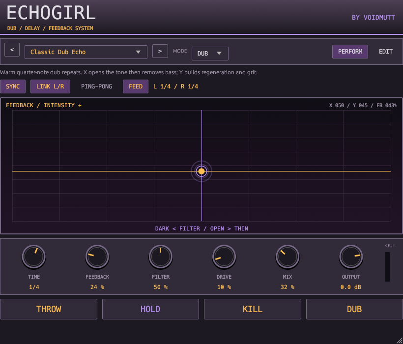
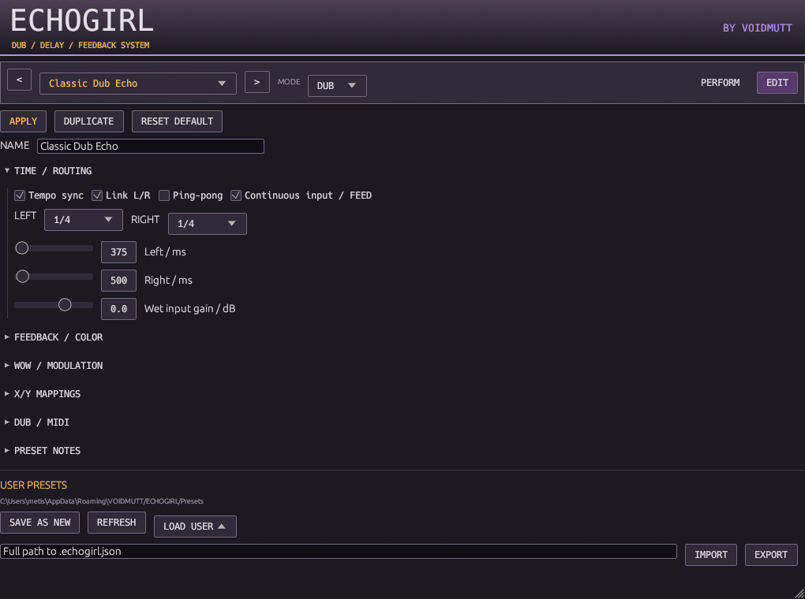

# ECHOGIRL

**DUB / DELAY / FEEDBACK SYSTEM — BY VOIDMUTT**

An independent stereo VST3 effect for delay throws, tape pitch movements,
filtered regeneration and live feedback swells. Windows x64 development build,
version 0.1.0. No DAWJ or VIXEN runtime dependency.



## Build and load

Use the root README prerequisites: Rust 1.93.0, Windows SDK/C++ build tools,
Python 3.10+ and the locked dependency cache. First-time `cargo fetch --locked`
requires network access. Subsequent builds work offline.

```powershell
cargo build --release -p echogirl-lab --locked --offline
target/release/echogirl-lab.exe render
powershell -NoProfile -ExecutionPolicy Bypass -File scripts/bundle.ps1 -Plugin ECHOGIRL
```

The entire bundle is `target/bundled/ECHOGIRL.vst3`; the inner Windows binary is
`Contents/x86_64-win/ECHOGIRL.vst3`. Resources contain licenses and ten portable
factory JSON presets. Factory sounds are also compiled into the plugin.

Point a host scanner at `target/bundled`, or manually copy the **whole bundle**
to a VST3 location. Nothing is installed automatically. In FL Studio, scan with
Plugin Manager, then load ECHOGIRL into a **Mixer effect slot** on a drum or synth
channel. It accepts stereo float32 audio; it is not an instrument generator.
On a send/return, set MIX to 100%; on an insert, begin with the preset mix.

## Play it

1. Select Classic Dub Echo and play a channel. FEED means continuous echo input.
2. Press THROW on a snare or chord; release to close new echo input. Existing
   repeats continue, and the dry channel continues through its normal mix path.
3. Move X from dark, low-passed echoes through open sound toward thin, high-passed
   echoes. Raise Y to add feedback, then drive and resonant coloration.
4. HOLD sustains the captured echo without adding new input. Move time in TAPE
   mode for intentional pitch movement. Release HOLD to decay normally.
5. Hold DUB for the preset's alternate feedback/drive/filter transformation.
6. KILL fades and clears wet history in 5 ms. Release to play another throw.
   Click FEED to return to continuous input.

THROW, KILL and DUB are momentary mouse controls. A very short click is latched
for one editor frame so it is not lost; held gestures follow press/release.
Closing the editor releases its own held momentary buttons. HOLD is a toggle;
CC/automation can also control it as a gate. KILL wins over HOLD and THROW and
releases them when triggered through the wrapper. None of these gates controls
the dry branch. At MIX=100%, there is intentionally no dry signal.

TIME chooses the left musical division with SYNC on, or 10–12000 ms with SYNC
off. LINK L/R makes right time follow left; EDIT exposes independent right time.
Divisions run from sixteenth triplets to whole notes, with dotted and triplet
choices. Host tempo is bounded to 20–400 BPM; absent tempo defaults to 120 BPM.
The six main knobs are TIME, base FEEDBACK, base FILTER, base DRIVE, MIX, OUTPUT.
Drag vertically; double-click a knob to reset. Double-click the pad for X=center,
Y=zero. The pad's FB readout shows the mapped feedback target, not just its base.
Hover controls for help. Factory and saved user presets share the main selector.

## Characters and gain staging

| Character | Behavior |
| --- | --- |
| CLEAN | Full-band option, no intrinsic saturation, two-head time crossfades |
| TAPE | Softer bandwidth, saturation, wow/flutter, slewed head for pitch movement |
| DIRTY | Stronger saturation and reduced bandwidth, two-head time crossfades |
| DUB | Voiced resonant feedback color, saturation, two-head time crossfades |

All characters share one stereo engine. Stereo mode preserves separate inputs;
ping-pong folds the wet input to mono into the left side and alternates repeats
between channels. Routing changes are smoothed. FREE independent times and
stereo ping-pong produce different rhythmic patterns.

The loop is read -> HP -> resonant LP -> 8 Hz DC rejection -> normalized soft
saturation -> feedback routing/gain -> bounded write. INPUT GAIN trims only the
wet feed. DRIVE has output-only makeup; its normalized loop saturation avoids
accidentally multiplying small-signal feedback gain. MIX is linear, so it does
not add an equal-power boost. OUTPUT trims the complete mix.

Feedback can reach 1.08 before coloration losses. Loop values are transparently
bounded above magnitude 1, with asymptotic limit 2. Final output has a soft knee
at 0.95 and asymptotic limit 1; ordinary low-level dry unity remains exact. These
are nonlinear safeguards, not lookahead limiting. Explicit bypass crossfades to
untrimmed dry audio and clears old echoes after the fade. Bypassed dry is
transparent, including peaks above 1. The effect reports zero added latency.

The optional spring-inspired stage is a small damped allpass diffuser on the
wet output, outside the feedback loop. It supplies synthetic metallic space;
it is not a physical spring/tank emulation. Nonlinear stages are not oversampled;
extreme distortion can alias. TAPE is a character, not verified machine emulation.

## Ten factory presets

Each portable preset includes a description and its full editable mapping.

| Preset | Starting point |
| --- | --- |
| Classic Dub Echo | Warm quarter-note repeats and playable filtered regeneration |
| Springy Dub Space | Dotted eighth/quarter ping-pong with metallic diffusion |
| Tape Drift | Unequal free times, moving tape head and wow/flutter |
| Jungle Snare Throw | Gated input, rhythmic ping-pong and dirty snare repeats |
| Garage Shuffle | Clean triplet/dotted shuffle between the channels |
| Deep Dubstep Space | Dark, slower throws with low-end filtering |
| Dub Techno Wash | Dotted stereo tape patterns and diffusion |
| Feedback Screamer | Short, resonant regeneration with aggressive Y travel |
| Dirty Digital Echo | Unequal millisecond repeats and reduced bandwidth |
| Endless Drone | Long tape repeats; capture and sustain with HOLD |

The offline demonstrations use original synthesized noise/snare/chord input,
120 BPM, moving X/Y, throws, DUB, HOLD and KILL. They are eight-second stereo WAVs
under `target/echogirl-demos`, with a peak/RMS manifest. No proprietary recordings
are included. The presets need musician listening review in real tracks.

## Edit, save and share



EDIT edits a draft; APPLY makes it audible through host parameters. Sections
cover times/routing, feedback color, modulation, eight mapping slots, DUB/CC
assignments and notes. Draft changes do not affect sound until APPLY. Factory
selection and main performance controls are immediate. RESET DEFAULT restores
Classic Dub Echo; selecting any factory sound restores that source recipe.

Rename the draft NAME and use SAVE AS NEW to write
`%APPDATA%/VOIDMUTT/ECHOGIRL/Presets/<name>.echogirl.json`. DUPLICATE gives a copy
name; rename/save preserves the previous file. REFRESH or REFRESH USER BANK
updates the browser. IMPORT/EXPORT use the full entered file path. Save/export
write the current draft and release transient buttons. Existing files are never
overwritten; rename or choose another path. User presets are selectable from
the main performance selector, with no need to reopen EDIT.

Portable files are strict JSON, version 1, maximum 32 KiB. Names are at most
32 UTF-8 bytes; notes at most 1024 bytes. Unknown fields, invalid enums,
nonfinite/out-of-range values and duplicate MIDI assignments are rejected before
application. There is no older schema to migrate yet; unsupported future versions
are rejected rather than guessed. Factory source remains immutable.

Host sessions preserve applied settings, name/notes, mapping slots, MIDI X/Y/
feed/bypass overrides and window size. Unapplied drafts and audio recordings in
the echo buffer are not saved. HOLD/THROW/KILL/DUB restore released, with empty
history. Preset browsing releases those buttons and morphs existing echoes; it
does not reload old audio. Actual host save/restore has been compared against
the independent engine while stopped.

## Automation and MIDI

Base knobs and X/Y are separate host parameters. A route adds
`depth * sign(axis) * abs(axis)^curve` to its target; X is bipolar around center,
Y is 0–1. Signed depth sets polarity. Combined targets clamp after all routes and
the DUB transformation. Targets: filter, feedback, drive, mix, modulation depth,
spring amount, right-time spread and resonance. For example, base FEEDBACK=0.24
plus a curved Y route can grow to near-unity feedback. Moving the base knob does
not move X/Y or rewrite the mapping. The effect smooths targets over about 8 ms.

Default MIDI CCs: 16 X, 17 Y, 18 THROW, 19 HOLD, 20 KILL, 21 DUB, 22 FEED,
23 BYPASS. Assign distinct CCs 0–119 in EDIT; button values >=0.5 are engaged.
The host must route MIDI controllers to the effect. MIDI values latch until the
corresponding host value changes or a GUI gesture clears the override. Repeated
unchanged host values do not take priority over MIDI. For automation-only
throws, write FEED=off before THROW=on, release THROW, then write FEED=on to
resume continuous input. The GUI records the FEED transition when THROW is used.
MIDI FEED=on resumes directly. Avoid competing automation/MIDI for one control
when recording a performance.

Transport stop/start alone preserves echoes and HOLD while callbacks continue;
tempo changes retime them using the chosen character. Tempo-synced modulation
follows host beats and stops phase advancement when stopped. Explicit host reset
or sample-rate reinitialization clears history. Supported rates: 8–192 kHz.
Hosts can suspend callbacks or reset effects on stop, so tail behavior must be
checked in the intended DAW. KeepAlive requests continuing processing for tails.

See [architecture](echogirl-architecture.md),
[validation and remaining qualification](echogirl-validation.md),
[asset slot](../assets/echogirl/README.md) and [licensing](licensing.md).
