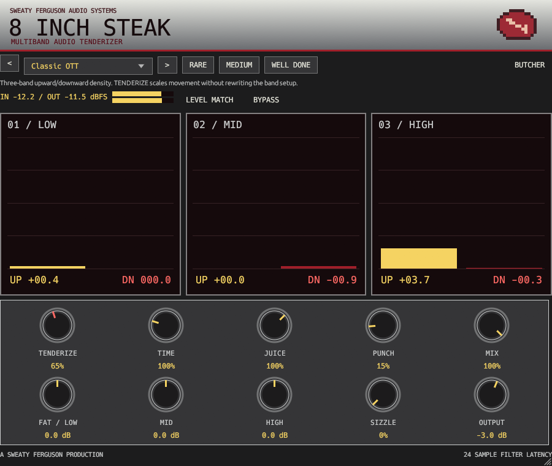
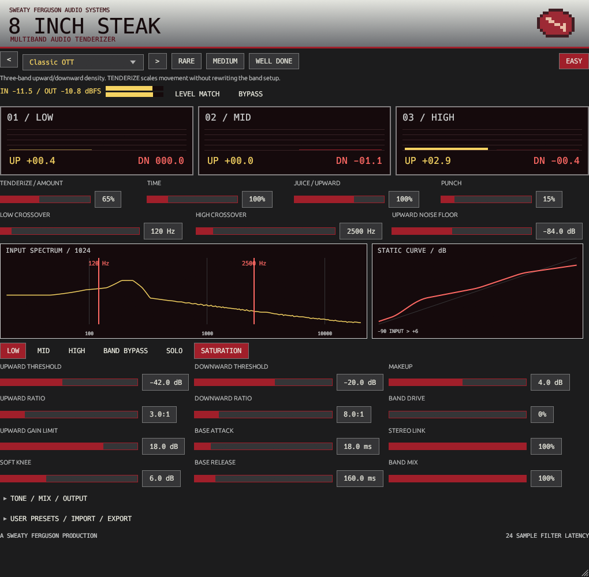

# 8 INCH STEAK / EIS

**MULTIBAND AUDIO TENDERIZER**  
**SWEATY FERGUSON AUDIO SYSTEMS**  
A Sweaty Ferguson Production

A GPLv3-compatible, independent stereo VST3 dynamics effect with upward and
downward compression, three bands, oversampled saturation and a deliberately
silver/red 2003 skin. Version 0.1.0, Windows x64 development build.



## Build and load

Use the root README prerequisites: Rust 1.93.0, Visual Studio C++ build tools,
Windows SDK and Python 3.10+. First fetch requires network access; subsequent
builds use the pinned lockfile and cached sources offline. No new external
dependencies were added for EIS.

```powershell
cargo fetch --locked
cargo build --release -p eis-lab --locked --offline
target/release/eis-lab.exe measure
target/release/eis-lab.exe render
powershell -NoProfile -ExecutionPolicy Bypass -File scripts/bundle.ps1 -Plugin EIS
```

The bundle is `target/bundled/EIS.vst3`, including factory files and license
notices. The inner binary is `Contents/x86_64-win/EIS.vst3`. Scan its parent
directory, or manually copy the **entire EIS.vst3 directory** to a VST3 location.
Nothing is automatically installed. In FL Studio, scan with Plugin Manager and
load **8 INCH STEAK** in a **Mixer effect slot**, not the Channel Rack.

## Easy mode

Start with Classic OTT, turn TENDERIZE, then adjust TIME and OUTPUT. RARE,
MEDIUM and WELL DONE set TENDERIZE to 25%, 65% and 115%; they preserve the complete
underlying band configuration. The eight factory recipes have distinct band
settings, rather than being three intensity buttons relabeled as presets.

| Control | DSP behavior |
| --- | --- |
| TENDERIZE / AMOUNT | 0–150% upward/downward movement strength; bounded before transfer slope can reverse |
| TIME | 10–400% multiplier on stored attack/release times |
| JUICE | 0–150% upward strength, before the per-band upward boost cap |
| PUNCH | Lengthens downward attack to preserve leading edges; adds no makeup gain |
| FAT / LOW | Low-band output trim, +/-12 dB |
| MID, HIGH | Respective band output trims, +/-12 dB |
| SIZZLE / DRIVE | Global saturation drive, added to each band's own drive |
| MIX | Linear blend with equally delayed, crossover-phase-aligned dry audio |
| OUTPUT | Final trim, -24 to +12 dB |

Drag knobs vertically, double-click to reset and hover for technical help.
BUTCHER opens the advanced view; EASY returns. Mode switching is immediate GUI
state, even when audio is suspended, and never resets the processor or changes
parameters. It is saved in host state, not exposed as an audio automation lane.

The giant meters show upward gain and downward reduction separately, in dB.
They exclude makeup, tone and saturation gain. Input/output sample-peak meters
have approximately 250 ms decay; the safety indicator holds briefly after a
clipped peak. Values and UP/DN labels keep the displays readable without relying
on color alone. LEVEL MATCH enables conservative automatic wet-level compensation.

TENDERIZE at zero removes compression movement after smoothing. Band makeup,
tone, saturation, MIX and OUTPUT remain independent controls. Use BYPASS for
the unprocessed comparison. The effect is not a true-peak limiter or a universal
mastering preset; match levels and judge it on the source.

## BUTCHER



The input spectrum is a 1024-frame Hann-window FFT computed on the GUI thread.
It combines left/right **power**, so antiphase material does not disappear.
Crossover target markers overlay it; the analyzer is a performance aid, not a
high-resolution measurement instrument. At 48 kHz, bin spacing is 46.875 Hz.
The selected band's static curve shows the stored settings plus macro intensity,
makeup and tone; time-dependent envelopes, MIX, saturation and final safety are
not represented in that curve.

Select LOW, MID or HIGH to edit its full processor. Both views manipulate the
same scalar parameters immediately; there is no separate advanced patch draft.

| Setting | Range / interpretation |
| --- | --- |
| Low crossover | 40–1000 Hz; default 120 Hz |
| High crossover | 600–16000 Hz; default 2500 Hz; effective minimum 1.5x low, maximum 0.4x sample rate |
| Upward threshold / ratio | -72 to -6 dBFS; 1:1 to 12:1 |
| Downward threshold / ratio | -48 to 0 dBFS; 1:1 to 40:1 |
| Attack / release | Base 0.1–150 ms / 10–1000 ms, scaled by TIME |
| Makeup | -12 to +18 dB, separate from upward compression |
| Upward limit | 0–24 dB maximum upward gain |
| Knee | 0–18 dB soft knee |
| Band drive | 0–100%; added to SIZZLE and clamped |
| Stereo link | Independent detection at 0%, shared maximum envelope at 100% |
| Band mix | Equally delayed processed/unprocessed band blend |
| Band bypass | Removes band dynamics, makeup, saturation and tone trim; retains its crossover |
| Solo | Fades other bands out and overrides global MIX to monitor wet bands only |
| Saturation | Independently enables or bypasses the selected band's nonlinear path |

Sliders support fine shift-dragging, reset and numeric entry through the native
parameter widget. Enter the displayed units, such as `4 ms`, `-24 dB`, `3:1` or
`65%`. The tone/MIX/OUTPUT section exposes the remaining Easy controls and the
explicit OUTPUT SAFETY toggle. Stored upward thresholds above the downward
threshold are limited during processing; portable preset validation rejects that
configuration. Crossover constraints likewise protect independent host automation.

## Macro and dynamics definition

Base thresholds, ratios, times and makeup remain stored exactly as edited.
Macros transform their effective values, never rewrite them. Both bases and
macros serialize and automate independently, so editing a base while TENDERIZE
is high changes the audible result relative to that macro setting.

For detector level `L` in dBFS, upward threshold `Tu`, downward threshold `Td`,
ratios `Ru/Rd`, AMOUNT `A` and JUICE `J`:

```text
up strength   = min(0.99, A * J * (1 - 1/Ru))
down strength = min(0.99, A * (1 - 1/Rd))
up gain       = min(upward limit, up strength * knee(min(Tu,Td) - L)) * floor fade
down gain     = -min(48 dB, down strength * knee(L - Td))
```

`knee` is a quadratic soft positive part with the selected width. At zero width,
it is `max(0,x)`. Below the detector noise floor, upward gain is zero; an 18 dB
smoothstep region above that floor restores it. The default floor is -84 dBFS.
This is genuine level-dependent upward compression, not a makeup-gain surrogate.
The strength bound prevents negative static slopes beyond 100% macro intensity.

Internal peak detection has a fast 50 us rise and 5 ms decay. Upward gain rises
with base ATTACK x TIME and returns in 0.5 ms on loud transients. Downward attack
is `ATTACK x TIME x (1 + 12*PUNCH^2)`; downward release is RELEASE x TIME.
The fixed fast upward return and detector timing do not scale with TIME.
Parameter targets smooth over about 8 ms; crossover coefficients over 20 ms.

## Signal routing, latency and safety

Serial fourth-order Linkwitz–Riley splits use cascaded Butterworth sections,
with allpass compensation on earlier bands. Their static sum has flat magnitude
and allpass phase. Processing does not promise a null against raw input or
linear phase. MIX=0 uses that same allpass sum, avoiding phase cancellation at
partial MIX settings. BYPASS crossfades to delayed raw stereo instead.

Per-band routing is detector -> upward/downward gain -> makeup -> saturation/
aligned band dry -> band MIX -> tone -> solo -> sum. The saturation path uses
two halfband stages for 4x processing, tanh shaping and drive compensation.
Unsaturated/bypassed bands, global dry and raw bypass all align to **24 samples**,
reported to the host at every supported rate. At 48 kHz this is 0.5 ms of filter
latency, not lookahead; frequency-dependent crossover phase is additional phase
response, not another fixed delay. Latency never changes when saturation toggles.

LEVEL MATCH measures one-second stereo input/wet energy, limits compensation to
-12/+6 dB and slews both application and removal at no more than 2 dB/second.
It freezes its estimate on very quiet input or during solo. Matching affects wet
before MIX; it never boosts the dry branch. Presets store the toggle, not a second
saved compensation gain. Host restore clears its history. It is conservative
RMS-based comparison assistance, not perfect perceived loudness matching.

Output trim follows MIX. Optional safety is transparent below magnitude 0.98,
then approaches magnitude 1 with a soft ceiling. It is nonlinear protection, not
lookahead/true-peak limiting. Explicit bypass retains raw level, including peaks
above 1. Inputs are finite-sanitized and extreme values bounded at magnitude 32;
tiny state values are flushed to prevent denormals. Disable safety deliberately
when floating-point headroom is required, then manage OUTPUT.

## Presets and persistence

Factory recipes: **Classic OTT, Hyper, Reese, Drum Smash, Air Lift, Bass Violence,
Glue, Destroy**. Their full descriptions appear in the selector. They cover dense
leads, sub-conscious bass treatment, transient-focused percussion, lifted detail,
gentle bus dynamics and deliberate destruction. None is universally appropriate
for mastering. Hyper/Air Lift output trims were calibrated against generated
review material to avoid relying on the safety ceiling at their defaults.

In BUTCHER, expand USER PRESETS / IMPORT / EXPORT. Edit NAME/notes, DUPLICATE,
APPLY NAME, or SAVE AS NEW. Save uses the current sound parameters and writes
`%APPDATA%/SweatyFerguson/EIS/Presets/<name>.eis.json`. Rename/save creates another
file and preserves the previous version. Existing files are never overwritten.
REFRESH BANK updates the main selector, where user presets can be loaded directly
from Easy. IMPORT/EXPORT use the full entered path. RESET DEFAULT loads Classic;
selecting a factory recipe always recovers its protected source settings.

Portable JSON is version 1, maximum 32 KiB, with strict fields/ranges/enums and
finite numbers. Names allow 1–32 UTF-8 bytes; notes at most 1024 bytes. Unsupported
versions are rejected; future schema changes need explicit migrations. Session
state contains all applied scalar settings, fixed-size name/notes, view and editor
size, not detector/FIR/audio history. Host restore starts deterministically fresh.
Restore while quiescent; arbitrary concurrent framework state parsing is not
qualified as real-time-safe. Own preset selection uses parameter gestures and
does not invoke host state replacement.

## Measure and audition

```powershell
cargo fmt --all -- --check
cargo check --workspace --locked --offline
cargo clippy --workspace --all-targets --locked --offline -- -D warnings
cargo test --workspace --locked --offline
python scripts/dependencies.py
target/release/eis-lab.exe smoke target/bundled/EIS.vst3
target/release/eis-lab.exe measure
target/release/eis-lab.exe render
target/release/eis-lab.exe profile
target/release/eis-lab.exe editor target/bundled/EIS.vst3 60 900 760 butcher
```

`render` exports eight factory JSON presets and eight-second stereo examples,
plus original input. Each preset also has a **matched-input / matched-output
pair** at a common, measured level for that pair, using attenuation only and
sample-peak headroom. Compare those pairs to reduce loudness bias. Different
pairs can have different target levels; the regular preset WAVs are untouched.
The manifest records peaks before/after safety, RMS, per-band gain movement and
offline BS.1770-style loudness estimates. This development estimator is not a
certified meter and does not measure true peak.

`measure` writes crossover and transfer CSVs, measured detector/gain results,
noise-floor amplification, transient responses and a local 1x/4x saturation
comparison. Additional input/processed WAVs cover impulses, white/pink noise,
log sweeps, level steps and asymmetric stereo. All material is original and
procedurally generated; no commercial recordings or plugin samples are bundled.

See [architecture/research](eis-architecture.md),
[milestone results and remaining qualification](eis-validation.md),
[skin provenance](../assets/eis/README.md) and [licensing](licensing.md).
External sidechain, four-band GUI, M/S, alternate detector types and linear-phase
crossovers remain future work. DAWJ integration requires separate review.
