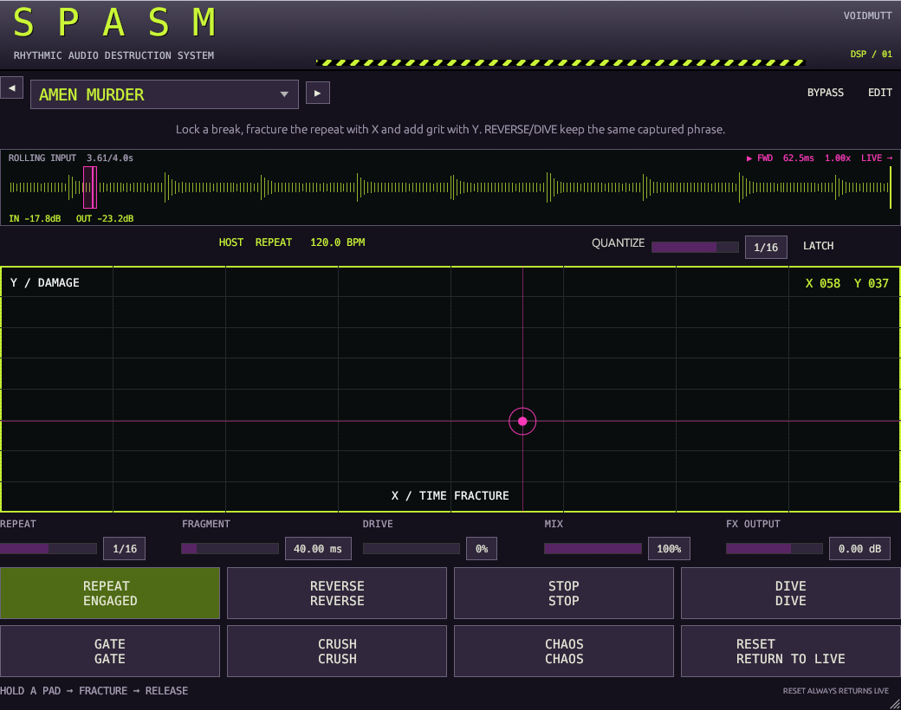
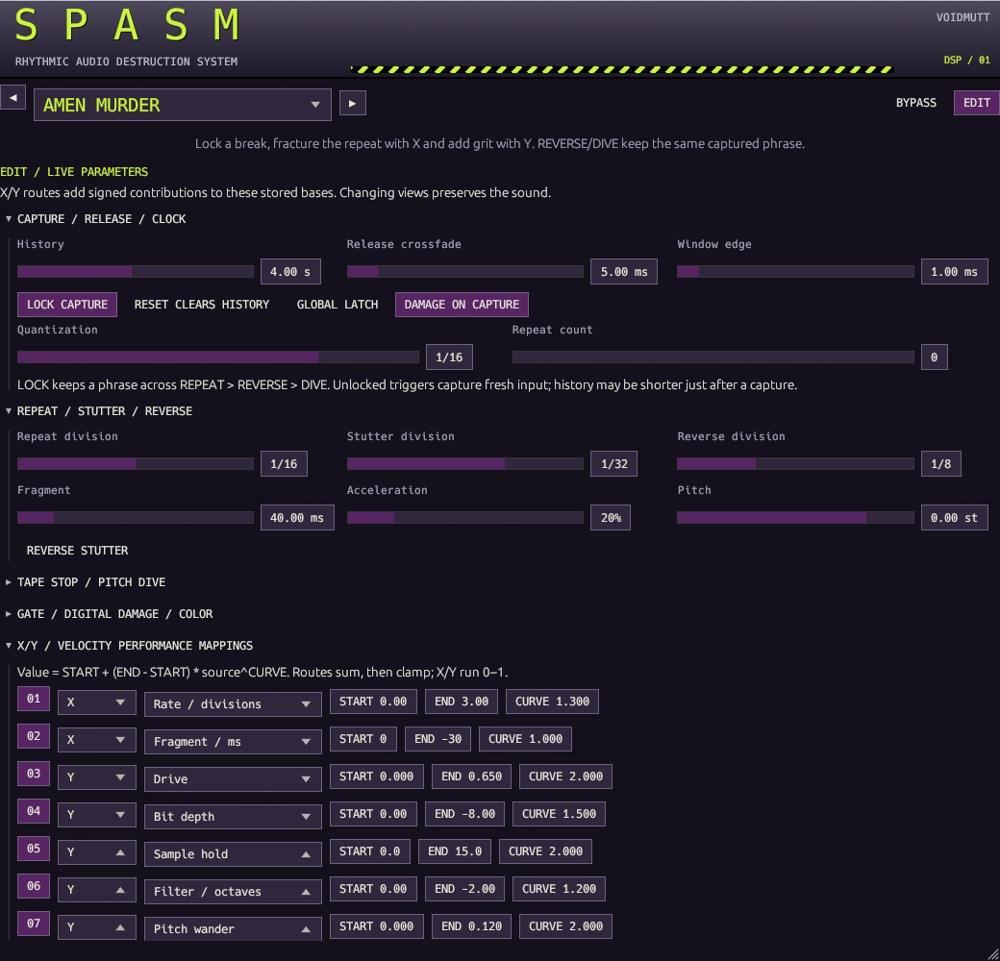

# SPASM

**RHYTHMIC AUDIO DESTRUCTION SYSTEM / BY VOIDMUTT**

Standalone Windows x64 stereo VST3 effect. Insert it on a mixer channel, let it
capture some audio, hold a pad and move **TIME FRACTURE / DAMAGE**. Release to
return to the live input. **RESET** always cancels the performance immediately,
then fades clean over the configured release (default 5 ms).



## Play

The main view contains a large X/Y pad, eight performance pads, quantization,
repeat division, fragment size, drive, wet/dry mix and wet output trim. Every
control works on the same automated parameters exposed to the host.

| Pad | Default action |
| --- | --- |
| REPEAT | Loop a recent musical subdivision; some presets assign Stutter here |
| REVERSE | Read the captured phrase backwards |
| STOP | Slow captured playback and pitch to a stop |
| DIVE | Sweep captured playback pitch downward; duration changes too |
| GATE | Apply the editable 16-step rhythm to the current audio |
| CRUSH | Sample hold and bit-depth reduction |
| CHAOS | Deterministic, seeded musical changes among enabled modules |
| RESET | Cancel pending, active and latched actions; return clean |

Pads show **WAIT / GRID**, **ENGAGED**, and **LATCH** from the engine state.
Mouse pads are momentary unless global or per-pad latch is enabled. A latched pad
toggles on the next press. Closing the editor releases its held momentary pads;
MIDI and host automation remain independent control sources. RESET never latches.

Quantization delays activation, not release: letting go before the boundary cancels
the pending action. Choose OFF for immediate cuts. Labels use conventional note
values: 1/4 is one quarter-note beat; 1/8 is half a beat. Repeat supports
1/2 through 1/128 notes. X adds discrete subdivisions with reader crossfades;
continuous coloration and pitch controls smooth over approximately 8 ms.

One captured-audio processor runs at a time. Default priority is
**STOP > DIVE > REVERSE > STUTTER > REPEAT**. Gate and Crush can overlay it.
Explicit pads outrank CHAOS. Releasing a higher-priority pad returns to another
held pad. EDIT can change assignments and priority.
An optional finite repeat count ends the performance and requires a fresh press.

Default LOCK CAPTURE keeps the phrase when moving from Repeat to Reverse to Dive.
Disable it for fresh captures on press. Live recording continues in a separate
bank while captured audio plays. Fresh history may be short just after a capture;
SPASM shortens the requested window and shows **SHORT CAPTURE**. Below 32 captured
frames it stays clean and armed. Immediate activation waits until ready;
quantized activation waits for the next usable grid. Reverse captures the past
at activation, including the current input frame; it never reads future audio.

The waveform is a decimated rolling **input** display. Green marks the input edge;
magenta marks the capture region and direction-adjusted readhead while visible.
**FROZEN / OFFSCREEN** means the locked phrase predates the visible history.
No raw capture memory is shared with the GUI.

MIX linearly blends clean input and the active processed signal. FX OUTPUT and
coloration apply only to that wet branch. Idle and completed RESET are exact unity
for ordinary finite input, even with destructive macros set high. Wet output is
bounded to ±1; dry input is not clipped at unity. Nonfinite/extreme input is
sanitized. No added latency, audio feedback or accumulated gain loop.

## Factory performances

Ten original parameter recipes are supplied as editable `.spasm.json` files.
The names describe performance techniques; no proprietary break recordings are
included. The main view displays each preset's intended use and X/Y behavior.

| Preset | Starting technique |
| --- | --- |
| Amen Murder | Locked phrase, progressively finer cuts and gritty damage |
| Jungle Roll | Eighth-note repeats, longer stutters, syncopated gate |
| Drill Stutter | Tiny fragments and strong repeat acceleration |
| Tape Collapse | Two-beat stop, long pitch dive, darkened wet path |
| Reverse Madness | Quarter-note reverse and backward stutters |
| Digital Shrapnel | Coarse 9-bit texture and sample holding |
| Breakcore Meltdown | Fast divisions, broad seeded CHAOS and pitch wander |
| Half-Time Crush | Half-speed playback, longer captures, octave drop |
| Glitch Scratch | Immediate backward stutter with bipolar pitch sweep |
| Emergency Rave Damage | Immediate aggressive cuts; RESET also clears history |

Changing presets releases existing triggers, MIDI holds, pending and latched
actions, with a short transition. It preserves available recording history.
Factory definitions remain protected; changes are saved as user presets.

## EDIT and portable presets

EDIT is a persisted view choice and does not alter DSP parameters. It exposes
capture/release, repeat/stutter/reverse, stop/dive, the gate pattern, resolution,
filter, drive, note/CC mappings, pad assignments, priority and CHAOS selection.

Eight performance routes can use X, Y or trigger velocity. Each has a destination,
signed START/END contributions, curve and enable switch:

`contribution = START + (END - START) * source^CURVE`

Routes add to stored base values, sum and clamp at musical limits. Changing a
base control never rewrites routes; moving the pad never overwrites base values.
Units appear beside destinations: divisions, milliseconds, semitones, octaves or
normalized amount. Changing a route destination zeros its endpoints. TIME FRACTURE
and DAMAGE are fixed family labels; EDIT shows the actual per-preset destinations.
For tempo-synced Stop, the Stop-time route adds milliseconds to the beat duration.
Filter routes change cutoff when LOW-PASS is enabled. Coloration is heard while
a performance pad is active.

USER PRESETS accepts a name and description. **SAVE AS NEW** snapshots current
live settings into `%APPDATA%/VOIDMUTT/SPASM/Presets`. **DUPLICATE** adds a COPY
suffix to the proposed name. **RENAME IN SESSION** changes its host metadata;
save under the new name for a renamed file. Files are never overwritten. REFRESH
updates the user entries in the main selector. IMPORT/EXPORT use an entered full
path; export also protects existing files. RESTORE FACTORY reloads the selected
factory recipe (first recipe when the current preset is a user preset).

Portable version 1 JSON is limited to 32 KiB. Unknown fields, future versions,
invalid ranges, duplicate note/CC assignments and malformed priority permutations
are rejected before application. Names are at most 32 UTF-8 bytes; descriptions
at most 1024. Under arbitrary host automation duplicate ranks/notes resolve
deterministically, but must be corrected before portable export.

Host state stores applied parameters, metadata, mappings, MIDI axis positions,
view and size. Uncommitted name/description text is a GUI draft. Trigger gestures,
pending actions and captured recordings are deliberately not restored: sessions
start clean with empty history. Restore state while processing is quiescent.



## MIDI and transport

Default notes **36–43** trigger the eight pads, with note-off release; repeated
note-ons are balanced separately per channel. Default **CC16/17** control X/Y.
Assignments and input channel (0 = omni) are editable and persistent. CC120/123
and note choke act as a performance panic. A host parameter gate and MIDI gate
combine; releasing one cannot release another still-held source.

MIDI axes latch until the corresponding host value changes, or a GUI X/Y gesture
takes over. Saved MIDI positions restore independently of host base X/Y. Host
automation and events use sample offsets, rather than GUI timers.

Tempo is clamped to 20–400 BPM. Missing/invalid tempo retains the last valid tempo,
initially 120 BPM. Without playing musical position a free-running grid advances.
Stop cancels actions and preserves history. Start clears history; seek/loop jumps
cancel actions and clear it. Held sources must release before rearming. RESET
preserves macros/settings/history by default; CLEAR HISTORY invalidates buffers
after the fade. Holding RESET keeps clean playback and blocks new effects.

The independent host verifies actual VST3 note and CC delivery. Conventional DAWs
can route MIDI to effects differently. In FL Studio, add SPASM to an **effect
slot**, and point Plugin Manager at `target/bundled`; scan VST3 effects. Use host
automation directly or configure the wrapper's MIDI input port and a matching
controller/MIDI Out port. This build's FL Studio port routing has not been tested.

## Build, render and verify

Uses the existing pinned Rust 1.93.0 Windows x64 toolchain and cached dependencies.
Run `cargo fetch --locked` first on a new machine with network access. No new
external dependencies or DAWJ runtime changes.

```powershell
cargo fmt --all -- --check
cargo check --workspace --locked --offline
cargo clippy --workspace --all-targets --locked --offline -- -D warnings
cargo test --workspace --locked --offline
python scripts/dependencies.py
cargo run --release -p spasm-lab --locked --offline -- render
powershell -NoProfile -ExecutionPolicy Bypass -File scripts/bundle.ps1 -Plugin SPASM
cargo run --release -p spasm-lab --locked --offline -- smoke target/bundled/SPASM.vst3
cargo run --release -p spasm-lab --locked --offline -- profile
target/validation/pluginval/pluginval.exe --strictness-level 5 --random-seed 42 --output-dir target/spasm-validation --output-filename pluginval.txt --validate target/bundled/SPASM.vst3
```

Bundle: `target/bundled/SPASM.vst3`. Copy the whole directory if installing
manually; the build does not install anything. Demo output: `target/spasm-demos`
(original 138-BPM procedural input, ten performances, seven focused module performances,
manifest). All 18 WAVs are 10 seconds, 48 kHz stereo. Demos use synthesized
percussion/bass/chords rather than a recorded Amen break; audition with your own
material before relying on a recipe.

`spasm-lab editor target/bundled/SPASM.vst3 30 1040 820 performance demo` opens a
native editor and processes/discards real synthetic audio offline. Optional `demo`
injects a note and X/Y automation after one second. `edit` replaces `performance`
to inspect that view. No audio device is opened. GUI/native lifecycle uses the
existing serialized development-host path, never DAWJ's experimental playback.

## Limits

This is an early Windows x64 build with measured automated gates, not a live-show
qualification. Pitch uses linear variable-speed resampling; pitch and duration
remain coupled. Stop restart acceleration and transparent independent time
stretching are deferred. Digital damage and drive intentionally alias; filtering
is a compact one-pole low-pass, not a mastering filter. Sample-edge tapers and
crossfades reduce clicks without promising artifact-free arbitrary edits.

Three prepared eight-second banks cost about 9.22 MB at 48 kHz and 36.87 MB at
192 kHz. Rates supported by this wrapper: 8–192 kHz, stereo float32 only. Four
beats at extremely slow tempos can exceed eight seconds and will shorten.
No buffer contents are serialized; first triggers after load/start need history.

FL Studio/device playback, physical pointer/pad focus interactions, touch,
cross-machine DPI and live listening remain manual gates. Framework JSON state
parsing and arbitrary concurrent lifecycle operations are not certified for an
audio callback. macOS/Linux bundles, external sidechain and DAWJ integration are
not supplied. See [architecture](spasm-architecture.md),
[validation evidence](spasm-validation.md) and [licensing](licensing.md).
