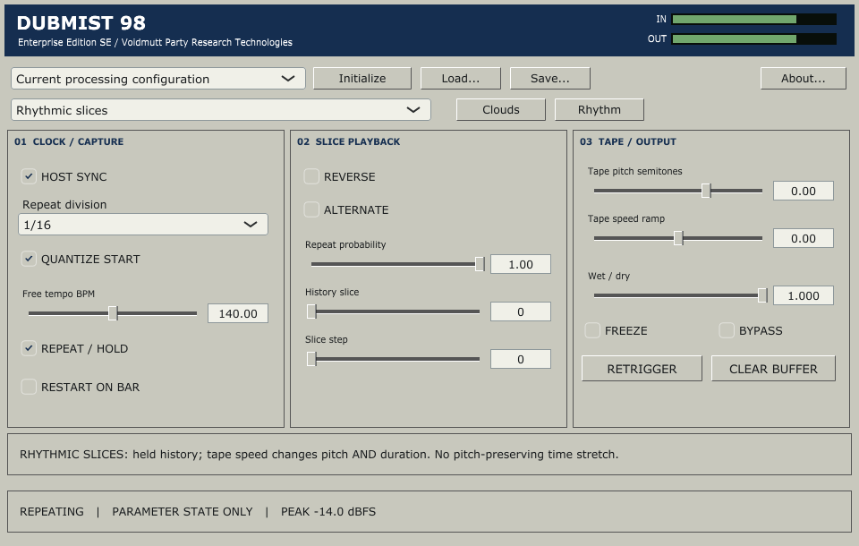
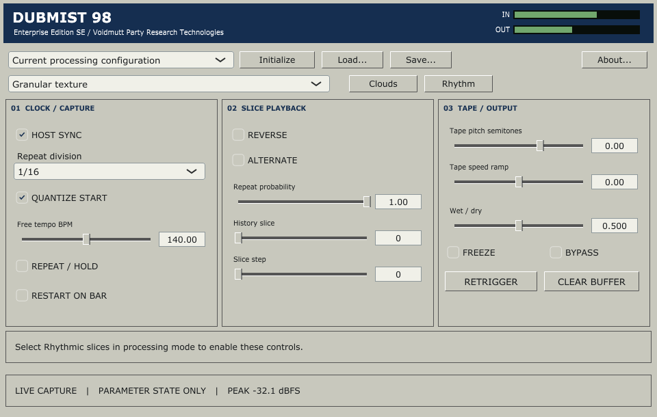

# DUBMIST 98
## Enterprise Edition SE

**Voidmutt Party Research Technologies**  
Published by **Voidmutt Enterprises**  
Windows x64 stereo VST3 effect | Version 0.2 | GPLv3

### Granular processing for the departmental soundsystem

Dubmist is based on **Mutable Instruments Clouds, created by Emilie Gillet**.
It brings the original Clouds processor to a desktop
insert, with Monsoon-style independent blend controls and a compact workstation
interface. Position, size, density, texture, pitch, mix, spread, feedback and
reverb are directly accessible. Freeze captures live material for further work.



This is a **milestone 3a preview**: the original Clouds modes plus a dedicated
host-rate rhythmic slice processor. It now supplies synchronized repeat, reverse,
alternating direction, stepping, probability, retrigger and tape-speed movement.
It is a documented adaptation of Kammerl concepts/curves, not the complete
firmware port. Bass preservation and quantized Clouds grain/freeze scheduling
remain separate work. Listening and FL Studio/DAWJ testing are outstanding.

See [rhythm operation, architecture and tests](docs/rhythm-milestone.md) and the
[scope/remaining-work note](docs/next-step-note.md).

### Supplied facilities

- Original granular texture, WSOLA pitch/time stretch, looping delay and spectral
  modes. Original grain windows/distribution, feedback/reverb and coloration remain.
- Dedicated mix, spread, feedback and reverb controls, inspired by Monsoon.
- Original stereo/mono 16-bit and low-rate mu-law quality options.
- Rhythmic slices with host BPM/PPQ or free tempo; 1/4 to 1/64 divisions and triplets;
  quantized capture/retrigger; reverse, alternate, history selection and stepping;
  repeat probability and tape pitch/speed ramps.
- Latched Freeze, immediate Trigger Grain, momentary Clear Buffer and smoothed
  bypass, with input/output gain and monitoring.
- Stereo and mono-to-stereo input layouts; stereo output. Bandlimited causal
  conversion preserves the original 32 kHz DSP rate at 32–192 kHz host rates.
- Thirty-one stable automatable parameters, versioned parameter-only project state,
  portable patch files and twelve independent factory configurations.
- Native raised/recessed controls, numeric entry, Shift-fine dragging, double-click
  defaults, tooltips and conventional keyboard navigation. No copied artwork.

Install packages and ready-to-copy bundles: [release directory](../../releases/README.md).

### Installation

The build produces a **directory bundle** `Dubmist 98.vst3`. Copy the entire
directory, including Contents, into a VST3 folder scanned by your host. A common
Windows location is `C:\Program Files\Common Files\VST3`, which may require
administrator permission. The build does not install system-wide automatically.

```text
VSTs/target/dubmist-cmake/Dubmist98_artefacts/Release/VST3/Dubmist 98.vst3
```

Insert it as a stereo audio effect, not an instrument. DAWJ must supply ordinary
VST3 effect hosting; the plugin has no DAWJ dependency and makes no host changes.

### Build and verification

Install Visual Studio C++ x64 Build Tools, Windows SDK and CMake integration,
plus Git and Python 3. From the VSTs repository root:

```powershell
powershell -NoProfile -ExecutionPolicy Bypass -File plugins/dubmist98/scripts/build.ps1
python plugins/dubmist98/scripts/check_sources.py
```

Bootstrap obtains and verifies JUCE 7.0.12 at its pinned revision, under its GPLv3
option. Original Clouds/stmlib source is vendored. No sibling plugin/application
source is needed. Full logs, WAV examples and captures stay in
`target/dubmist-cmake`. See [validation](docs/validation.md) for executed checks and
their limits. The complete-source archive also includes the framework for offline
builds; its source manifest is verified by bootstrap.

### Operation

Feed live audio before freezing. Position reads the captured buffer, size controls
grain duration, density controls grain activity/randomization, and texture changes
grain windows/diffusion in granular mode. Near the center, density permits sparse
or manually triggered grains. The original alternate modes reinterpret these
controls; the status strip identifies the selected mode.

Choose **Vocal Freeze Ready**, feed a phrase, then engage Freeze. It deliberately
does not start frozen on an empty buffer. Clear Buffer fades out, clears original
recording and effect memory, then fades back in. Mode/quality changes also reset
the capture with a fade. Original fixed memory sizes are retained; there is no
untested larger-buffer slider.

Mix retains Clouds' original curve and conversion coloration. At Mix zero the
signal still passes through the original rate/bit-depth path. **Bypass** instead
uses the delayed desktop dry path, aligned to reported latency. Gains remain
active during bypass. Audio capture continues in the background while bypassed.
Freeze can sustain indefinitely, so the plugin reports an infinite potential tail.

Save writes complete `*.dm98.xml` configurations. Projects store the same
parameters, **not recorded audio**. Restoring a fresh frozen instance therefore
has an empty buffer until unfrozen and fed input. Clear/Trigger actions save as
zero and do not fire merely because a project is reopened.

### Factory configurations

Classic Cloud; Jungle Grain Scatter; Breakcore Micrograin; Dark 140 Mist;
Vocal Freeze Ready; Dub Loop; Spectral Glass; Stretch Bed; Vintage Mono;
175 Break Roll; 140 Reverse Fill; Triplet Ping-Pong.
The three rhythm presets use free tempo for offline auditioning; enable Host Sync
to follow your DAW. No preset claims bass preservation. Examples now include a
CC0 recorded SK-5 loop retimed to 140/175 BPM, with input/repeat/reverse exports,
as well as the previous synthetic signals. They are not acoustic Amen recordings.

Select **Rhythmic slices** to open the Rhythm panel. Feed at least one division
of audio and engage Repeat/Hold. Host Sync requires BPM, PPQ and playing state;
without those, turn sync off and use Free Tempo. Quantize Start affects capture
and retrigger starts; release fades immediately. Holds stop writes to an eight-
second history snapshot. Tape speed changes pitch AND duration. Mix/gains/bypass
are shared, while Clouds spread/feedback/reverb/quality apply only to Clouds.



### Attribution and service information

**Clouds and stmlib by Emilie Gillet / Mutable Instruments**, MIT-licensed, are
the foundation. **Monsoon by Jak Plugg** informs control organization, not DSP.
Rhythmic tape-speed curves are adapted from Julius Kammerl's MIT player; the
host scheduler/history implementation is GPLv3 integration. Parasites remains
a reference only. The complete Kammerl firmware is not compiled wholesale. No Mutable Instruments brand
identity, hardware panel artwork or VCV graphics are reused.

New integration: Copyright 2026 Dubmist contributors, GPL-3.0-or-later.
JUCE and its bundled older VST3 SDK use their GPLv3 options. All applicable notices
remain intact. See [LICENSE](LICENSE), [NOTICE](NOTICE), [licensing](docs/licensing.md),
[investigation/architecture](docs/investigation.md), and
[remaining milestones](docs/validation.md). Independent product; no affiliation,
endorsement or certification is claimed.
