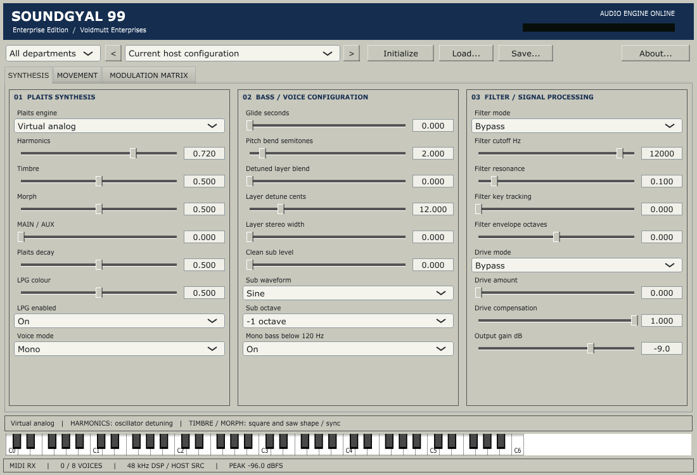
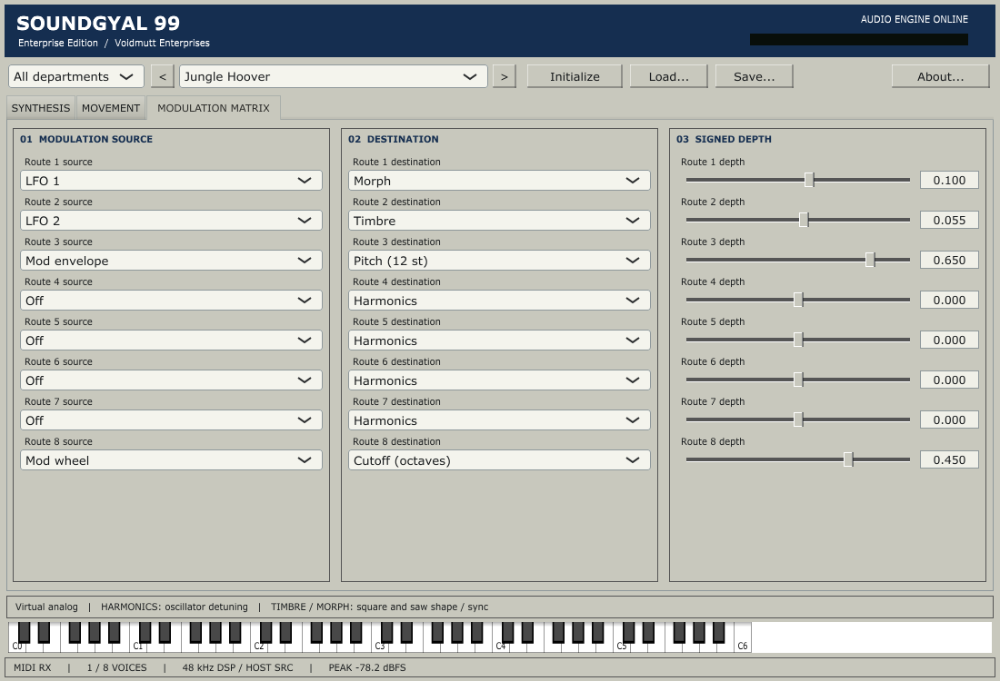

# SOUNDGYAL 99
## Enterprise Edition

**Voidmutt Enterprises | Version 0.3 | Windows x64 VST3 | GPLv3**

### Serious synthesis. Standard office equipment.

Twenty-four original Plaits engines, a clean central sub, animated stereo layers
and an editable modulation matrix. Preserve the physical models, speech, FM,
digital oddities and percussion while building bass-heavy patches.



This is a **functional instrument preview**, with automated VST3 validation.
Reference listening comparison and FL Studio/DAWJ testing have not occurred.
The factory sounds are authored starting points, pending listening review.
See the [validation record and remaining work](docs/validation.md).

### Facilities supplied

| Department | Facilities |
| --- | --- |
| Synthesis | All 24 original Plaits slots; HARMONICS, TIMBRE, MORPH; MAIN/AUX; trigger, decay, optional LPG |
| Bass | Detuned second Plaits layer; width; centered sine/triangle sub, octave and independent level |
| Voices | Mono, legato, eight-voice polyphony, quietest/oldest stealing, glide, velocity, bend, sustain, wheel |
| Processing | Bypass/LP/HP/BP filter, resonance, key tracking, filter envelope; saturation, hard clip, wavefold, compensation, DC removal |
| Movement | Two ADSRs, two four-shape LFOs with free Hz or tempo sync, eight bipolar modulation routes |
| Patches | 35 independent factory configurations; categories; previous/next; initialize; portable save/load; versioned VST3 state |
| Output | Low-frequency side reduction, central sub, gain, peak indication; 32-192 kHz host rates via windowed-sinc conversion |

### Install

Copy the **entire directory bundle** `SOUNDGYAL 99.vst3`, including Contents, to a
VST3 folder scanned by your DAW. A common Windows location is
`C:\Program Files\Common Files\VST3`, which can require administrator permission.
The build does not install automatically. Local build output:

```text
VSTs/target/soundgyal-cmake/Soundgyal99_artefacts/Release/VST3/SOUNDGYAL 99.vst3
```

Scan for SOUNDGYAL 99 by Voidmutt Enterprises, load an instrument track, route
MIDI and enable stereo output. DAWJ must supply ordinary VST3 hosting; there is no
DAWJ dependency and no host changes in this project.

### Build

Install Visual Studio C++ x64 Build Tools with Windows SDK and CMake integration,
Git, and Python 3. From the VSTs root:

```powershell
powershell -NoProfile -ExecutionPolicy Bypass -File plugins/soundgyal99/scripts/build-vst3.ps1
python plugins/soundgyal99/scripts/check_sources.py
```

Bootstrap fetches pinned JUCE 7.0.12 and verifies its revision. Plaits and stmlib
are vendored. No RiffCalc or DAWJ sources are required. Use
`-DSOUNDGYAL_BUILD_PLUGIN=OFF` for a core-only CMake build. The original
`scripts/build.ps1` remains an original-engine-only MSVC check. WAVs, captures,
test applications and logs remain under `VSTs/target/soundgyal-cmake`.

### Preset bank revision 0.3

Jungle Hoover now uses a pitched VA/PWM-style recipe instead of a dispersed
granular swarm. Ten new configurations bring the bank to 35, with a dedicated
DUBSTEP category. See [preset notes, references and audition guidance](docs/presets-0.3.md).
Saved 0.2 projects retain their original configurations; reselect the factory
Hoover to load the corrected recipe.

### Operate

Choose a factory configuration and play MIDI. HARMONICS, TIMBRE and MORPH retain
**engine-specific meanings**. MAIN/AUX blends original outputs, not a stereo pair.
SYNTHESIS supplies the sound and processing; MOVEMENT supplies ADSRs/LFOs;
MODULATION MATRIX supplies routing. Drag sliders, Shift-drag for fine adjustment,
double-click for defaults, or type values. Tab navigation and conventional combo
keyboard operation are available. The keyboard auditions without an audio-thread
GUI lock.



Save writes complete `*.sg99.xml` files. DAW state carries the same configuration,
independent of factory indices and external files. Initialize resets all controls.
No output limiter hides gain: leave headroom when stacking voices or adding drive.
See the [operator manual](docs/manual.md) and [architecture](docs/architecture.md).

### Credits

**Plaits and stmlib by Emilie Gillet / Mutable Instruments** are the foundation.
Their MIT notices remain intact. SOUNDGYAL is independent; no endorsement or
affiliation is implied. New code and recipes: Copyright 2026 SOUNDGYAL contributors,
GPL-3.0-or-later. Voidmutt Enterprises is the publisher identity.

JUCE 7 and its bundled SDK use their GPLv3 options. Other dependencies retain
original notices. See [LICENSE](LICENSE), [NOTICE](NOTICE), [UPSTREAM.md](UPSTREAM.md),
[licensing](docs/licensing.md), [notices](notices) and [desktop changes](docs/desktop.patch).
No copied OS artwork, custom fonts, Mutable Instruments product branding or
generated imagery is used.
